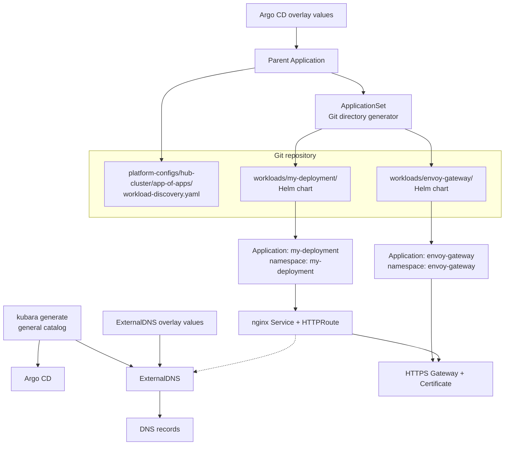

# Dynamic Argo CD application discovery

An Argo CD App-of-Apps pattern that discovers Helm chart directories from Git and deploys each directory as an independently reconciled Argo CD Application.

> [!WARNING]
> This example is a reference pattern, not a production-hardened configuration. Review and adapt repository permissions, AppProject restrictions, network policies, DNS, certificate issuer settings, image versions, and security contexts before using it in a live environment.

## Purpose

kubara catalogs package reusable platform architecture. A workload owned by one cluster or team does not necessarily need the overhead of maintaining a custom catalog.

The pattern in this project makes helm deployments dynamic. The App-of-Apps ApplicationSet is based on the following idea: Add a Helm chart directory under `platform-configs/hub-cluster/workloads/`. Argo CD discovers it and creates one Application in a namespace derived from the directory name. Removing that directory removes the generated Application and, through automated pruning, its managed resources.

The two starting directories demonstrate the pattern:

- `envoy-gateway` wraps the pinned upstream Envoy Gateway chart, creates a cert-manager `Certificate`, and owns an HTTPS `Gateway`.
- `my-deployment` deploys a small nginx workload and attaches its `HTTPRoute` to that Gateway.

## Architecture



## Type and prerequisites

- **Type**: `Architecture Pattern`
- **Related kubara concepts**: general catalog, workload onboarding, Argo CD Applications, ApplicationSets, AppProjects, cert-manager, ExternalDNS

Before adopting this pattern:

1. Use the latest kubara release and general catalog to generate a basic setup
2. Add the app-of-apps directory to your cluster
3. Replace every `https://github.com/your-org/your-platform-repo.git` occurrence with your GitOps Repo Url and replace the cluster name and cluster project
4. Configure the hostname and ClusterIssuer in the Envoy Gateway chart values. The supplied `nginx.example.com` and `letsencrypt-staging` values are examples; a public ACME issuer can issue a certificate only for a hostname you control. Update `domainFilters` in the ExternalDNS overlay to match your domain.

## Structure

```text
argo-dynamic-app-discovery/
├── README.md
├── config.yaml
└── platform-configs/
    └── hub-cluster/
        ├── app-of-apps/
        │   └── workload-discovery.yaml        # ApplicationSet manifest only
        ├── helm/
        │   ├── argo-cd/
        │   │   └── values-additional.yaml     # Creates the parent Application
        │   └── external-dns/
        │       └── values-additional.yaml     # Configures Gateway API route sources
        └── workloads/
            ├── envoy-gateway/
            │   ├── Chart.yaml                 # Pinned OCI dependency
            │   ├── values.yaml                # TLS hostname and ClusterIssuer
            │   └── templates/
            │       ├── certificate.yaml
            │       ├── gatewayclass.yaml
            │       └── gateway.yaml
            └── my-deployment/
                ├── Chart.yaml
                ├── values.yaml
                └── templates/
                    ├── deployment.yaml
                    ├── service.yaml
                    └── httproute.yaml
```

## Pattern walkthrough

### 1. Generate the kubara platform foundation

`config.yaml` selects kubara's general catalog and enables cert-manager. Set the Git URL, DNS name, and cert-manager ClusterIssuer values for your environment, then generate and bootstrap as usual:

```bash
kubara generate
kubara bootstrap hub-cluster
```

Two Helm overlays customize the platform services:

- `platform-configs/hub-cluster/helm/argo-cd/values-additional.yaml` adds a parent Application named `hub-cluster-dev-workload-discovery`. Its source is the dedicated `app-of-apps/` manifest directory, which contains only the ApplicationSet resource.
- `platform-configs/hub-cluster/helm/external-dns/values-additional.yaml` configures ExternalDNS with Gateway API sources (`gateway-httproute`, `gateway-grpcroute`, `gateway-tlsroute`) and sets `domainFilters`. This allows ExternalDNS to discover hostnames from `HTTPRoute` resources automatically.

### 2. Discover chart directories

`workload-discovery.yaml` uses the Git directory generator:

```yaml
generators:
  - git:
      directories:
        - path: platform-configs/hub-cluster/workloads/*
```

For every matching directory, the template creates an Application whose source path and namespace use the directory name. The `automated.prune` policy makes a removed directory delete its generated Application's managed resources. `SkipDryRunOnMissingResource=true` allows the nginx Application to converge while Envoy Gateway is first installing Gateway API CRDs.

All discovered directories must be deployable Helm chart directories. If applications need different projects, repositories, revisions, or namespace rules, use a Git files generator with explicit per-application metadata instead.

### 3. Configure HTTPS and DNS

The Envoy Gateway chart creates:

- a cert-manager `Certificate` named `envoy-gateway`;
- the `Secret` named by `tls.secretName`;
- an HTTPS `Gateway` that references that Secret.

Before deploying, set these values in `workloads/envoy-gateway/values.yaml`:

```yaml
tls:
  hostname: nginx.your-domain.example
  issuerRef:
    name: your-existing-cluster-issuer
    kind: ClusterIssuer
```

The my-deployment chart's `route.hostname` must match `tls.hostname`. Its HTTPRoute references the Gateway in the `envoy-gateway` namespace. The Gateway permits routes from all namespaces so the directory-derived `my-deployment` namespace can attach.

ExternalDNS monitors the HTTPRoute and creates the corresponding DNS records pointing to the Gateway address. Adjust `domainFilters` in `platform-configs/hub-cluster/helm/external-dns/values-additional.yaml` to ensure your domain is included.

### 4. Add another workload

To onboard another workload, add a Helm chart directory beside `envoy-gateway` and `my-deployment`:

```text
platform-configs/hub-cluster/workloads/
└── my-application/
    ├── Chart.yaml
    ├── values.yaml
    └── templates/
```

Commit and push it. The ApplicationSet creates an Argo CD Application named `my-application` and deploys it to namespace `my-application`. Removing the directory reverses that action.

## Adoption and integration

This pattern intentionally does not add a custom kubara catalog. It keeps application-specific Helm logic close to its Git-managed workload and relies on Kubara only for the general platform and Argo CD foundation.

Use a catalog instead when Envoy Gateway and its routing policy are a repeated, centrally governed platform capability across many clusters. In that case, catalog templates and service definitions provide a different interface for configuration, validation, and cross-cluster defaults.

## Where to go from here

- [kubara: Catalogs](https://docs.kubara.io/next/2_concepts/catalogs/index.md)
- [kubara: Add an ApplicationSet](https://docs.kubara.io/next/5_workload_onboarding/add_appset/index.md)
- [kubara: App of Apps](https://docs.kubara.io/next/4_building_your_platform/argocd-add-app-of-apps/index.md)
- [Argo CD: Git generator](https://argo-cd.readthedocs.io/en/stable/operator-manual/applicationset/Generators-Git/)
- [Envoy Gateway](https://gateway.envoyproxy.io/)
- [Gateway API](https://gateway-api.sigs.k8s.io/)
- [ExternalDNS: Gateway API](https://kubernetes-sigs.github.io/external-dns/latest/tutorials/gateway-api/)
