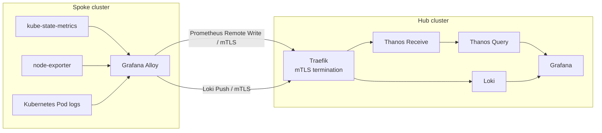
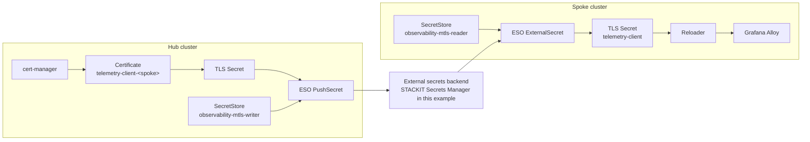
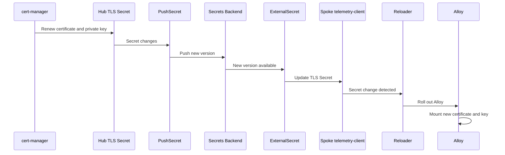

# Centralized observability for kubara hub-and-spoke clusters

A reference architecture for centralizing spoke metrics and logs on a kubara Hub while protecting cross-cluster ingestion with automatically rotated mTLS client certificates.

> [!WARNING]
> This example is an architecture pattern, not a production-ready configuration. Review and adapt DNS, storage, high availability, credentials, network policies, tenancy, and secret isolation before production use.

## Purpose

Running a complete observability stack on every spoke increases resource usage and operational overhead.

This pattern demonstrates a centralized model where:

- the **Hub** runs Grafana, Thanos, Loki, and telemetry ingress;
- each **spoke** runs lightweight exporters and Grafana Alloy;
- metrics and logs are pushed from spokes to the Hub;
- cross-cluster ingestion is protected with mTLS;
- cert-manager manages one client certificate per spoke;
- External Secrets Operator distributes certificates through an external secrets backend;
- Reloader restarts Alloy when the client certificate changes;
- Argo CD ApplicationSets generate per-spoke mTLS resources from small spoke descriptors.

The implementation was validated with STACKIT Secrets Manager, while keeping the mTLS charts independent of the secrets provider.

## Architecture

### Telemetry flow



### Automated mTLS certificate distribution



### Certificate rotation



## Type and prerequisites

- **Type**: `Architecture Pattern`
- **Related kubara concepts**: Hub-and-spoke clusters, Argo CD, cert-manager, External Secrets Operator, Reloader.

### Prerequisites and context

The pattern assumes:

- a kubara Hub with at least one registered spoke;
- Argo CD manages Hub and spoke resources;
- cert-manager is enabled on the Hub;
- External Secrets Operator is enabled on the Hub and participating spokes;
- Reloader is enabled on participating spokes;
- a secrets backend is available for certificate exchange;
- the Hub has write access to that backend;
- spokes use read-only backend identities;
- telemetry endpoints are reachable from the spokes.

The committed example uses portable placeholder endpoints:

```text
loki.observability.example.com
thanos.observability.example.com
```

For local kind testing, `scripts/configure-kind-endpoints.sh` replaces them with hostnames based on the current Hub container IP.

## Component ownership

| Owner | Responsibility |
| --- | --- |
| kubara | Argo CD, cert-manager, External Secrets Operator, Reloader |
| Observability pattern | Certificate, PushSecret, ExternalSecret, ApplicationSets, Alloy mTLS configuration |
| Provider integration | SecretStore configuration and backend credentials |
| Secrets backend | Exchange of per-spoke client certificate material |

The generic charts depend only on two logical SecretStores:

```text
Hub:   observability-mtls-writer
Spoke: observability-mtls-reader
```

The charts do not contain provider credentials or instance-specific authentication details.

## Structure

```text
hub-spoke-centralized-observability/
├── README.md
├── argocd/
│   ├── project.yaml
│   ├── hub-pki.yaml
│   ├── hub-thanos.yaml
│   ├── hub-loki.yaml
│   ├── hub-grafana.yaml
│   ├── spoke-1-alloy.yaml
│   ├── spoke-1-exporters.yaml
│   ├── mtls-hub-clients-appset.yaml
│   └── mtls-spoke-clients-appset.yaml
├── charts/
│   ├── mtls-hub-client/
│   └── mtls-spoke-client/
├── hub/
│   ├── pki/
│   ├── thanos/
│   ├── loki/
│   └── grafana/
├── spoke/
│   ├── alloy/
│   └── exporters/
├── spokes/
│   └── spoke-1.yaml
├── providers/
│   └── stackit/
├── scripts/
│   ├── add-spoke.sh
│   └── configure-kind-endpoints.sh
└── platform-configs/
    └── hub-cluster/
        └── helm/
            └── kube-prometheus-stack/
                └── values-observability-poc.yaml
```

## Pattern walkthrough

### 1. Centralize telemetry on the Hub

The Hub runs:

- Grafana;
- Thanos Receive;
- Thanos Query;
- Loki;
- Traefik.

Traefik exposes the metrics and logs ingestion endpoints and requires a valid client certificate.

Grafana-to-Thanos and Grafana-to-Loki traffic remains cluster-local.

### 2. Keep spokes lightweight

Each spoke runs:

- Grafana Alloy;
- kube-state-metrics;
- node-exporter.

Alloy discovers local metrics and Pod logs and forwards them to the Hub.

Telemetry includes cluster identity labels:

```text
cluster="spoke-1"
cluster_type="spoke"
stage="local"
```

### 3. Generate one client certificate per spoke

The Hub mTLS chart creates:

```text
Certificate telemetry-client-<spoke>
Secret telemetry-client-<spoke>
PushSecret telemetry-client-<spoke>
```

Certificates use ECDSA keys with explicit private-key rotation:

```yaml
privateKey:
  algorithm: ECDSA
  size: 256
  rotationPolicy: Always
```

The PoC uses:

```yaml
duration: 168h
renewBefore: 24h
```

### 4. Publish certificates through the secrets backend

ESO `PushSecret` publishes:

```text
ca.crt
tls.crt
tls.key
```

under:

```text
observability/mtls/clients/<spoke-name>
```

The Hub uses:

```text
observability-mtls-writer
```

### 5. Retrieve certificates on the spoke

The spoke `ExternalSecret` reads the remote object through:

```text
observability-mtls-reader
```

and creates the stable workload-facing Secret:

```text
telemetry-client
```

Alloy therefore uses the same Secret name on every spoke.

### 6. Reload Alloy after certificate rotation

The Alloy Deployment uses:

```yaml
secret.reloader.stakater.com/reload: "telemetry-client"
```

When External Secrets Operator updates the Secret, Reloader rolls the Alloy Deployment so the new certificate and private key are mounted.

### 7. Generate resources using ApplicationSets

A spoke is represented by a small descriptor:

```yaml
name: spoke-1
```

The descriptor generates two Argo CD Applications:

```text
observability-poc-mtls-hub-spoke-1
observability-poc-mtls-spoke-1
```

The Hub Application manages:

```text
Certificate
PushSecret
```

The spoke Application manages:

```text
ExternalSecret
```

This avoids maintaining dedicated certificate-delivery manifests for every spoke.

## Adding another spoke

After a spoke is registered with kubara/Argo CD and the required platform components are enabled, configure its provider-specific SecretStore.

For STACKIT:

```bash
./providers/stackit/configure-spoke.sh spoke-2
```

Then add the spoke descriptor:

```bash
./scripts/add-spoke.sh spoke-2
```

The resulting Git change is intentionally small:

```yaml
name: spoke-2
```

The ApplicationSets generate the corresponding Hub and spoke mTLS resources.

## STACKIT Secrets Manager implementation

STACKIT Secrets Manager was used to validate the provider integration.

The tested access model is:

```text
Hub writer
  └── read/write identity

Spoke reader
  └── read-only identity
```

The Hub requires write permission because `PushSecret` publishes certificate material.

A spoke only requires read access.

Provider-specific setup is isolated under:

```text
providers/stackit/
```

The Hub helper expects:

```bash
export STACKIT_SM_ID="<secrets-manager-id>"
export STACKIT_SM_RW_USERNAME="<rw-user>"

./providers/stackit/configure-hub.sh
```

The spoke helper expects:

```bash
export STACKIT_SM_ID="<secrets-manager-id>"
export STACKIT_SM_RO_USERNAME="<ro-user>"

./providers/stackit/configure-spoke.sh spoke-1
```

Passwords are requested interactively and are not committed to Git.

A different secrets backend can implement the same logical SecretStore contract without changing the generic mTLS charts.

## Local kind endpoints

The repository intentionally does not commit a Docker network address.

For local kind testing:

```bash
./scripts/configure-kind-endpoints.sh
```

The helper attempts to detect the IP of `hub-cluster-control-plane`.

An address can also be supplied explicitly:

```bash
./scripts/configure-kind-endpoints.sh <hub-kind-container-ip>
```

The helper updates the Loki and Thanos hostnames, server certificate SANs, and Alloy endpoints together.

## Validation performed

The PoC was validated end-to-end with a kubara Hub, one spoke, and STACKIT Secrets Manager.

### Metrics

Metrics were queried through Thanos:

```promql
kube_node_info{cluster="spoke-1",cluster_type="spoke",stage="local"}
```

```promql
node_cpu_seconds_total{cluster="spoke-1",cluster_type="spoke",stage="local"}
```

### Logs

Logs were queried through Loki:

```logql
{cluster="spoke-1",cluster_type="spoke",stage="local"}
```

### mTLS

The telemetry ingress was verified with and without a client certificate:

```text
without a client certificate -> rejected
with a valid spoke certificate -> accepted
```

### Certificate rotation

A renewal was manually triggered with `cmctl renew` to exercise the complete rotation path without waiting for the natural renewal window.

The test verified:

```text
Hub certificate rotated             PASS
Hub private key rotated             PASS
PushSecret synchronized             PASS
Spoke received new certificate      PASS
Spoke received new private key      PASS
Hub and spoke certificates matched  PASS
Reloader restarted Alloy            PASS
Alloy returned to 2/2 Running       PASS
Argo Applications remained Healthy  PASS
```

`cmctl renew` was only used to trigger the test. Normal renewal is handled by cert-manager according to the certificate renewal window.

## Adoption and integration

The example separates the provider-independent mTLS workflow from provider-specific SecretStore configuration.

Production adoption should additionally address:

- stable DNS instead of local kind hostnames;
- provider-integrated SecretStore provisioning;
- strict read-only credentials for spokes;
- per-spoke secret/path isolation;
- credential cleanup when a spoke is removed;
- production object storage for Thanos and Loki;
- high availability and disaster recovery;
- retention, tenancy, and quotas;
- centralized alerting;
- cluster labels derived from kubara metadata rather than fixed PoC values.

`PushSecret` currently uses a conservative deletion policy, so removing a spoke does not automatically remove its remote credential. Production offboarding should define that lifecycle explicitly.

## Where to go from here

- [kubara documentation](https://docs.kubara.io/)
- [kubara spoke cluster documentation](https://docs.kubara.io/v0.16.0/4_building_your_platform/add_spoke_cluster/index.md)
- [External Secrets Operator](https://external-secrets.io/)
- [cert-manager](https://cert-manager.io/)
- [Grafana Alloy](https://grafana.com/docs/alloy/latest/)
- [Thanos](https://thanos.io/)
- [Grafana Loki](https://grafana.com/docs/loki/latest/)
- [Argo CD ApplicationSet](https://argo-cd.readthedocs.io/en/stable/operator-manual/applicationset/)
